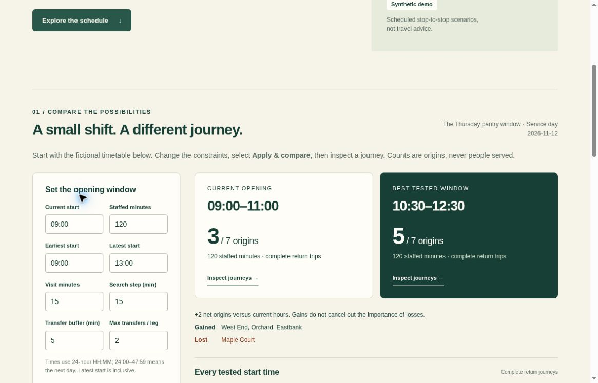

# OpenReturn

**Decision audit, exact backups and reused route searches, November 8, 2026.** This update adds schedule-burden summaries and hypothetical assumption checks, bounded exact JSON recovery, explicitly restricted CSV exports, and reuse of identical route searches. The cumulative runtime passed 445 tests, independent checks and bounded actual-browser acceptance. See the [current validation receipt](evidence/CUMULATIVE_ACCEPTANCE_20261108.md) and [routing-cache measurements](docs/ROUTING_CACHE.md). Physical-device, assistive-technology and field-usefulness limits remain. The screenshot below is from the earlier version; the current validation receipt documents this update.

**Opening hours only work if the bus home does.**

OpenReturn is an original, local-first prototype for a food-pantry operator comparing opening windows with the **same staffed duration**. It checks the complete scheduled journey: leave an origin, reach the pantry, finish a visit while it is open, and return within the stated time budget. It displays who gains and who loses in the supplied scenario rather than hiding a loss inside a better total.

The built-in timetable is entirely synthetic. No result is evidence that real people can reach a real pantry. The tool counts **origin scenarios**, not beneficiaries, households served, or equitable outcomes.



## Run

Node 24+ is used for tests. The application is buildless and has no third-party runtime dependencies.

```sh
npm test
npm run check
npm run serve
```

Open http://localhost:4193 in an available browser. The app uses JavaScript modules and must be served over HTTP rather than opened as a file. A deployed preview is not yet established by this README.

## Try the synthetic example

1. Compare the 09:00–11:00 baseline with candidate two-hour windows.
2. Inspect the best window's complete journeys and the explicitly listed lost origin.
3. Open South Wharf to see why an outbound bus alone is not enough.
4. Raise the transfer buffer from 5 to 10 minutes. Hilltop stays on the same vehicle through its interchange; West End changes vehicles and may lose its connection.
5. Export the scenario or decision sheet. Invalid input must not replace the current scenario.
6. Select **Check three assumptions**. The synthetic example falls from 5/7 to 2/7 if the selected 10:30 opening is kept while both the visit and transfer buffer increase. Searching again finds 3/7 at 09:00, which is no gain over current hours under those same changed assumptions.
7. Inspect the scheduled waiting ranges, each journey's wait breakdown and remaining time allowances. These numbers describe one retained timetable witness, not reliability or delay tolerance. Equal-count best windows need not serve the same origins.

All figures are computed from the input, not a claimed measured impact or forecast.

## Repeated-origin routing work

Origin scenarios at the same stop can share route searches when every relevant constraint matches, without merging their identity, coverage count, gains/losses or journey results. Per-call caches never carry across timetable or setting changes. In one synthetic Node benchmark at the model's maximum connection, origin and grid-window counts, identical-constraint routing took 0.272–0.282 seconds instead of 4.30–4.38 seconds. This is a cache-friendly example, not a general speedup or browser responsiveness guarantee. A distinct-constraint case still took several seconds. The app still computes synchronously and has no cancellation control. See [method, measurements and limits](docs/ROUTING_CACHE.md).

## Decision audit and offline report

An optional [integer-minute coverage audit](docs/COVERAGE_RANGES.md) identifies
feasible opening-start ranges that a coarse grid can miss, without changing
the existing browser or its grid. Run `node scripts/coverage-ranges.mjs` for the
synthetic example, or provide a scenario JSON path. It preserves explicit
origin gains/losses and distinguishes range start times from opening windows.

The audit separates four kinds of scheduled waiting: before the visit, after the visit, between vehicles, and on-board dwell. For each feasible witness it reports remaining minutes against the away allowance, home deadline, closing time, first return departure and tightest vehicle-change buffer. An absent return or vehicle change is **not applicable**, not zero headroom. Summary ranges exclude infeasible origins; a window with no feasible journeys does not report zero waiting.

Three explicit hypothetical checks add 15 visit minutes, add five transfer-buffer minutes, or do both. Each compares the applied best hours held fixed with a fresh grid search, identifies specific lost and gained origins, and compares the new best against current hours under the **same changed assumptions**. An out-of-bounds hypothesis is labeled not applicable instead of being clamped. Checks never change the applied scenario or draft, and are cleared when new data/settings are applied. They are not an exhaustive stress test or evidence of delay probabilities.

Generate the same decision-sheet text offline without a browser:

```sh
node scripts/decision-sheet.mjs > decision-sheet.txt
node scripts/decision-sheet.mjs your-scenario.json > decision-sheet.txt
```

The terminal accepts regular UTF-8 JSON files up to 4,000,000 raw bytes. Invalid UTF-8, JSON with a leading BOM, directories, symbolic-link inputs and special files are rejected without a report on stdout. Reads are bounded even if a file grows; they are not atomic snapshots, so avoid editing the file during export. With no input path, the synthetic sample is unchanged.

The terminal report includes all three assumption checks. A browser report includes them only after they have been run for the current applied data; otherwise it explicitly states that they were not run. [Synthetic report example](evidence/decision-sheet-synthetic.txt).

## Exact backup and restricted CSV

Use **scenario JSON** for a complete, lossless backup of applied data. The UTF-8 input/output cap is 4,000,000 bytes, sufficient for every normalized scenario within the v1 model bounds. JSON preserves all supported IDs, including IDs that cannot safely use the CSV helper. Exporting does not include unapplied drafts.

Timetable CSV has a 2,000,000-byte UTF-8 cap and contains connections only, not the complete scenario. CSV refuses IDs containing edge whitespace, control characters, unpaired UTF-16 surrogates, or a leading `=`, `+`, `-` or `@`. It directs you to JSON rather than silently changing an ID, creating an unreimportable file or emitting a formula-leading spreadsheet cell. This restriction applies to every CSV ID column. An unavailable CSV export or format change preserves applied data, drafts and the previous copyable export.

CSV is not a guarantee against spreadsheet auto-conversion: import every ID column as text and verify identities. Prefer JSON for exact storage. See [the export contract and capacity proof](docs/EXPORT_CONTRACT.md).

## Input and privacy

The scenario format is documented in [docs/DATA_FORMAT.md](docs/DATA_FORMAT.md). Paste JSON to replace a complete scenario, or select CSV to replace only its timetable connections while retaining its existing stops, origins and settings. Both modes require validation and confirmation before replacement. CSV must describe an already selected service-day timetable; it does not infer or verify the retained service-day label. **This is not a GTFS importer.** Do not paste an unfiltered GTFS feed and assume its service calendars, pickup restrictions or transfers have been interpreted.

Application code makes no network requests, uses no analytics, and does not store scenario content in localStorage. The server hosting the app may receive ordinary page requests. Keep anonymous stop labels and scenario IDs, not client names, home addresses, or sensitive demographic information. Explicit exported files remain on the device where they are saved. Reloading discards unsaved work.

## Model and limitations

The engine evaluates every start time on the user-selected finite grid. It does not optimize continuously outside that grid or assert that a transit route is a safe real journey. Each origin has its own earliest departure, latest return and maximum time away. A same-vehicle continuation uses no interchange buffer; a vehicle change does. Transfer caps apply separately to the outbound and return legs.

A feasible journey is a **schedule witness**, conditional on the supplied timetable and assumptions. There is no walking, stop access, fare, wheelchair access, boarding capacity, real-time delay, food availability, queue-length, eligibility, holiday, timezone or weather model. The user selects active service before input. The pickup duration is a scenario assumption, not a measured wait. Delays can invalidate every planned connection, even with a buffer.

Coverage alone is not a policy recommendation. An operator must consider the listed losses, staffing, consultation, accessibility and service constraints before changing hours. No operating hours are changed by this tool.

## Origin and evidence

New project work began November 8, 2026 for Code for Change, after its November 5 opening. See [docs/EVENT_AND_PRIOR_ART.md](docs/EVENT_AND_PRIOR_ART.md) for eligibility checks, source links and prior-art boundaries. AI-assisted implementation and review are disclosed. No new routing or fairness algorithm is claimed.

The [original independent routing checks](evidence/INDEPENDENT_REVIEW.md) and [original browser receipt](evidence/BROWSER_ACCEPTANCE.md) remain historical evidence for the earlier version. The [current cumulative receipt](evidence/CUMULATIVE_ACCEPTANCE_20261108.md) covers 445 passing tests, independent routing-cache and export checks, actual Chromium workflows, five synthetic saved-download byte comparisons, keyboard focus and narrow layouts. Node application-state tests use a minimal DOM double; they are separate from the actual browser observations. Physical phones, assistive technology, native leave-warning behavior, native print and field usefulness remain unverified.

This is a prototype, not a submitted event entry or a completed operational pilot.

### Reboarding oracle regression checks

The exhaustive test oracle now checks same-vehicle reboarding against the full trip chain, including omitted loop legs. `npm test` includes literal witness and fabricated-invalid-witness controls plus 120 deterministic looping timetables. Run `node scripts/verify-oracle-mutations.mjs` for five deliberately faulty local copies that must be detected. No packages or network are used.

This corrects a test-verifier blind spot, not a reproduced production-routing error. Reachability and minimum-away comparisons alone cannot distinguish waiting to reboard from riding the whole loop. See [the oracle correction and scope](evidence/ORACLE_REBOARDING_REVIEW.md). Historical review counts elsewhere describe their original snapshots.
